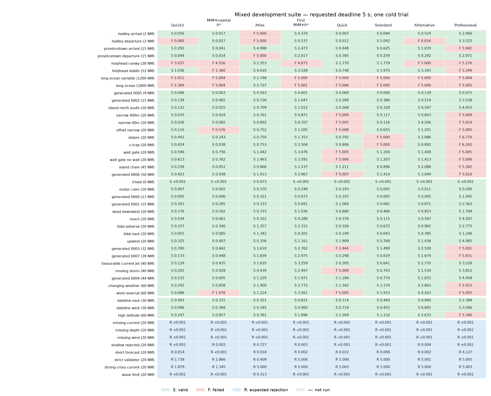
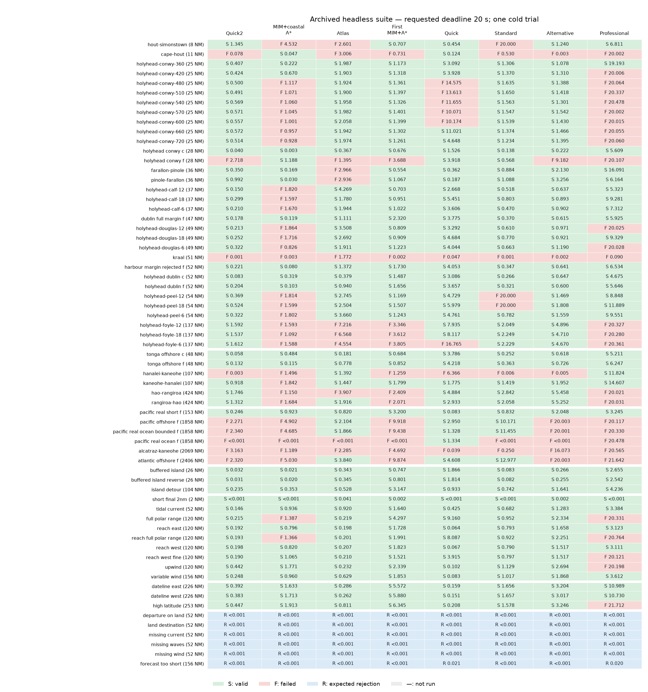
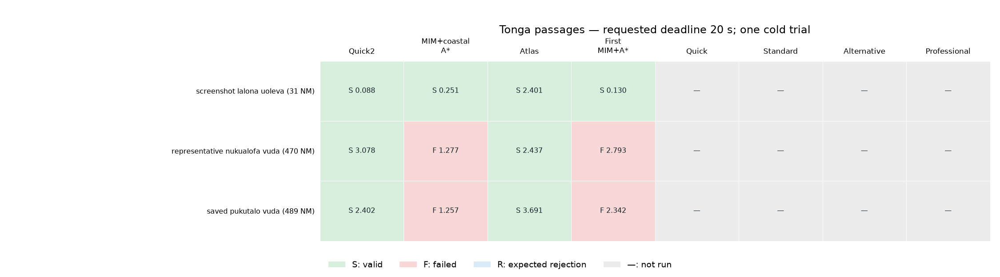

# Per-case engine timings

S = independently valid completion; F = no valid completion; R = expected rejection; ! = error or unexpected acceptance; — = not run. All times are seconds.

Each campaign is a separate set of measurements. Eight engines were measured for every mixed/archived case. Only four were measured on Tonga. Do not pool the campaigns.

One cold observation per cell; this is descriptive evidence, not statistical significance. Expected rejections are excluded from positive-route statistics. R records no valid completion on a rejection case; it does not by itself prove the reason was correct. A small failure time is not a fast solution.

Route settings describe the test intent; length bands use direct endpoint distance, not sailed length or measured coastal exposure. The dataset intentionally has many Holyhead departure variants, so it is not a representative sample of worldwide passages.

For colours and filtering, download [matrix.html](matrix.html) and open it in a browser. No server or network access is needed. [measurements.json](measurements.json) contains the sanitized observations; [statistics.json](statistics.json) contains the grouped calculations.

## Mixed development suite

Requested solver deadline: 5 s. Positive cases: 39; expected rejections: 8.

| Engine | Valid / run | Success median | Success mean | Failure median | Failure mean | All-attempt median |
| --- | ---: | ---: | ---: | ---: | ---: | ---: |
| Quick2 | 35/39 | 0.157 | 0.235 | 2.390 | 1.974 | 0.176 |
| MIM+coastal A* | 33/39 | 0.243 | 0.297 | 3.017 | 2.996 | 0.340 |
| Atlas | 36/39 | 0.782 | 1.197 | 5.000 | 5.000 | 0.866 |
| First MIM+A* | 36/39 | 1.429 | 1.654 | 5.000 | 4.958 | 1.537 |
| Quick | 28/39 | 0.508 | 0.639 | 5.006 | 4.773 | 0.792 |
| Standard | 35/39 | 0.641 | 0.721 | 5.000 | 5.000 | 0.672 |
| Alternative | 35/39 | 1.070 | 1.412 | 5.000 | 3.754 | 1.201 |
| Professional | 20/39 | 2.823 | 2.633 | 5.014 | 5.322 | 4.915 |

Success-only timings can compare different sets of cases. The same-case comparison below is restricted to cases all eight engines solved.

Common successes across all eight: 16.

| Engine | Same-case median | Same-case mean |
| --- | ---: | ---: |
| Quick2 | 0.109 | 0.120 |
| MIM+coastal A* | 0.223 | 0.223 |
| Atlas | 0.363 | 0.648 |
| First MIM+A* | 0.865 | 0.977 |
| Quick | 0.352 | 0.550 |
| Standard | 0.421 | 0.363 |
| Alternative | 0.720 | 0.737 |
| Professional | 2.669 | 2.525 |

### Coastal / harbour

| Case | Direct NM | Weather | Quick2 | MIM+coastal A* | Atlas | First MIM+A* | Quick | Standard | Alternative | Professional |
| --- | ---: | --- | ---: | ---: | ---: | ---: | ---: | ---: | ---: | ---: |
| `hadley_arrival` | 1.6 | Synthetic weather | S 0.056 | S 0.017 | F 5.000 | S 0.374 | S 0.007 | S 0.044 | S 0.524 | S 2.060 |
| `hadley_departure` | 1.6 | Synthetic weather | F 0.080 | S 0.027 | F 5.000 | S 0.537 | S 0.012 | S 2.042 | F 0.014 | S 3.522 |
| `provincetown_arrival` | 15.1 | Synthetic weather | S 0.292 | S 0.041 | S 4.998 | S 2.473 | S 0.448 | S 0.625 | S 1.070 | F 5.942 |
| `provincetown_departure` | 15.1 | Synthetic weather | S 0.044 | S 0.014 | F 5.000 | S 2.017 | S 0.385 | S 0.259 | S 0.242 | S 2.871 |
| `holyhead_conwy` | 28.0 | Synthetic weather | F 3.037 | F 4.556 | S 2.353 | F 4.873 | S 1.770 | S 1.779 | F 5.000 | F 5.276 |
| `holyhead_dublin` | 51.9 | Synthetic weather | S 1.036 | F 1.360 | S 4.010 | S 3.528 | S 0.748 | S 1.975 | S 3.343 | F 5.249 |

### Ocean / offshore

| Case | Direct NM | Weather | Quick2 | MIM+coastal A* | Atlas | First MIM+A* | Quick | Standard | Alternative | Professional |
| --- | ---: | --- | ---: | ---: | ---: | ---: | ---: | ---: | ---: | ---: |
| `long_ocean_variable` | 1200.0 | Synthetic weather | F 2.411 | F 5.004 | S 2.748 | F 5.000 | F 5.004 | F 5.000 | F 5.000 | F 5.004 |
| `long_ocean` | 1800.0 | Synthetic weather | F 2.369 | F 5.004 | S 2.727 | F 5.001 | F 5.006 | F 5.000 | F 5.000 | F 5.005 |

### Artificial obstacles

| Case | Direct NM | Weather | Quick2 | MIM+coastal A* | Atlas | First MIM+A* | Quick | Standard | Alternative | Professional |
| --- | ---: | --- | ---: | ---: | ---: | ---: | ---: | ---: | ---: | ---: |
| `generated_0005` | 9.0 | Synthetic weather | S 0.006 | S 0.003 | S 0.563 | S 0.601 | S 0.069 | S 0.006 | S 0.139 | S 0.075 |
| `generated_0002` | 14.5 | Synthetic weather | S 0.138 | S 0.465 | S 0.726 | S 1.047 | S 0.289 | S 0.386 | S 0.519 | S 3.538 |
| `island_north_south` | 20.0 | Synthetic weather | S 0.122 | S 0.025 | S 0.709 | S 1.012 | S 0.568 | S 0.328 | S 0.587 | S 4.915 |
| `narrow_400m` | 20.0 | Synthetic weather | S 0.035 | S 0.024 | S 0.761 | S 0.871 | F 5.009 | S 0.117 | S 0.603 | F 5.009 |
| `narrow_40m` | 20.0 | Synthetic weather | S 0.036 | S 0.082 | S 0.802 | S 0.707 | F 5.005 | S 0.116 | S 4.206 | F 5.014 |
| `offset_narrow` | 20.0 | Synthetic weather | S 0.116 | F 0.576 | S 0.752 | S 1.505 | F 5.008 | S 0.655 | S 1.201 | F 5.005 |
| `slalom` | 20.0 | Synthetic weather | S 0.441 | S 0.243 | S 0.750 | S 1.353 | S 0.792 | F 5.000 | S 2.086 | F 6.770 |
| `u_trap` | 20.0 | Synthetic weather | S 0.424 | S 0.038 | S 0.753 | S 2.504 | S 0.806 | F 5.000 | S 0.892 | F 6.242 |
| `wait_gate` | 20.0 | Synthetic weather | S 0.596 | S 0.756 | S 1.442 | S 3.476 | F 5.005 | S 1.204 | S 1.408 | F 5.005 |
| `wait_gate_no_wait` | 20.0 | Synthetic weather | S 0.613 | S 0.762 | S 1.463 | S 3.591 | F 5.006 | S 1.203 | S 1.413 | F 5.006 |
| `island_chain` | 45.0 | Synthetic weather | S 0.258 | S 0.051 | S 0.866 | S 1.537 | S 1.211 | S 0.896 | S 2.088 | F 5.382 |
| `generated_0006` | 49.7 | Synthetic weather | S 0.423 | S 0.938 | S 1.413 | S 2.967 | F 5.007 | S 1.414 | S 3.049 | F 5.010 |

### Open-water controls

| Case | Direct NM | Weather | Quick2 | MIM+coastal A* | Atlas | First MIM+A* | Quick | Standard | Alternative | Professional |
| --- | ---: | --- | ---: | ---: | ---: | ---: | ---: | ---: | ---: | ---: |
| `trivial` | 0.2 | Synthetic weather | S <0.001 | S <0.001 | S 0.073 | S <0.001 | S <0.001 | S <0.001 | S <0.001 | S <0.001 |
| `motor_calm` | 10.0 | Synthetic weather | S 0.007 | S 0.002 | S 0.370 | S 0.248 | S 0.193 | S 0.005 | S 0.011 | S 0.200 |
| `generated_0000` | 12.5 | Synthetic weather | S 0.005 | S 0.006 | S 0.321 | S 0.073 | S 0.197 | S 0.005 | S 0.005 | S 1.045 |
| `generated_0001` | 15.4 | Synthetic weather | S 0.341 | S 0.285 | S 0.333 | S 0.691 | S 1.064 | S 0.681 | S 0.871 | S 2.563 |
| `dead_downwind` | 20.0 | Synthetic weather | S 0.176 | S 0.162 | S 0.333 | S 1.036 | S 0.680 | S 0.466 | S 0.853 | S 1.794 |
| `reach` | 20.0 | Synthetic weather | S 0.034 | S 0.061 | S 0.322 | S 0.288 | S 0.378 | S 0.115 | S 0.587 | S 4.287 |
| `tidal_adverse` | 20.0 | Synthetic weather | S 0.157 | S 0.340 | S 1.357 | S 2.315 | S 0.326 | S 0.672 | S 0.962 | S 2.775 |
| `tidal_east` | 20.0 | Synthetic weather | S 0.055 | S 0.085 | S 1.342 | S 0.201 | S 0.199 | S 0.043 | S 0.385 | S 1.246 |
| `upwind` | 20.0 | Synthetic weather | S 0.325 | S 0.407 | S 0.356 | S 1.161 | S 1.909 | S 0.768 | S 1.436 | S 4.085 |
| `generated_0003` | 32.0 | Synthetic weather | S 0.390 | S 0.662 | S 1.610 | S 2.762 | F 2.444 | S 1.490 | S 2.528 | F 5.001 |
| `generated_0007` | 38.6 | Synthetic weather | S 0.133 | S 0.448 | S 1.839 | S 2.975 | S 0.298 | S 0.619 | S 1.674 | F 5.831 |
| `favourable_current_jet` | 40.0 | Synthetic weather | S 0.129 | S 0.435 | S 1.635 | S 3.259 | S 0.305 | S 0.641 | S 1.735 | S 3.528 |
| `moving_storm` | 40.0 | Synthetic weather | S 0.202 | S 0.428 | S 0.439 | S 2.497 | F 5.009 | S 0.743 | S 1.534 | S 3.812 |
| `generated_0004` | 43.5 | Synthetic weather | S 0.232 | S 0.605 | S 1.229 | S 1.971 | S 1.184 | S 0.774 | S 1.872 | S 4.458 |
| `changing_weather` | 60.0 | Synthetic weather | S 0.292 | S 0.858 | S 1.400 | S 2.772 | S 1.342 | S 1.174 | S 2.863 | F 5.023 |
| `wind_reversal` | 60.0 | Synthetic weather | S 0.686 | F 1.478 | S 1.214 | S 3.561 | F 5.005 | S 1.933 | S 4.263 | F 5.005 |

### Geographic stress

| Case | Direct NM | Weather | Quick2 | MIM+coastal A* | Atlas | First MIM+A* | Quick | Standard | Alternative | Professional |
| --- | ---: | --- | ---: | ---: | ---: | ---: | ---: | ---: | ---: | ---: |
| `dateline_east` | 30.0 | Synthetic weather | S 0.093 | S 0.315 | S 0.351 | S 0.831 | S 0.714 | S 0.464 | S 0.940 | S 2.389 |
| `dateline_west` | 30.0 | Synthetic weather | S 0.096 | S 0.369 | S 0.345 | S 0.900 | S 0.719 | S 0.455 | S 0.895 | S 3.506 |
| `high_latitude` | 60.0 | Synthetic weather | S 0.247 | S 0.857 | S 0.391 | S 1.896 | S 1.269 | S 1.132 | S 2.633 | F 5.346 |

### Expected rejection

| Case | Direct NM | Weather | Quick2 | MIM+coastal A* | Atlas | First MIM+A* | Quick | Standard | Alternative | Professional |
| --- | ---: | --- | ---: | ---: | ---: | ---: | ---: | ---: | ---: | ---: |
| `missing_current` | 20.0 | Synthetic weather | R <0.001 | R <0.001 | R <0.001 | R <0.001 | R <0.001 | R <0.001 | R <0.001 | R <0.001 |
| `missing_depth` | 20.0 | Synthetic weather | R <0.001 | R <0.001 | R <0.001 | R <0.001 | R <0.001 | R <0.001 | R <0.001 | R <0.001 |
| `missing_wind` | 20.0 | Synthetic weather | R <0.001 | R <0.001 | R <0.001 | R <0.001 | R <0.001 | R <0.001 | R <0.001 | R <0.001 |
| `shallow_rejected` | 20.0 | Synthetic weather | R <0.001 | R 0.002 | R 0.727 | R 0.003 | R <0.001 | R <0.001 | R 0.004 | R <0.001 |
| `short_forecast` | 20.0 | Synthetic weather | R 0.014 | R <0.001 | R 0.918 | R 0.002 | R 0.022 | R 0.006 | R 0.002 | R 4.127 |
| `strict_validator` | 20.0 | Synthetic weather | R 1.738 | R 1.866 | R 0.409 | R 5.006 | R 5.006 | R 5.000 | R 5.001 | R 5.005 |
| `strong_cross_current` | 20.0 | Synthetic weather | R 1.879 | R 1.345 | R 5.000 | R 5.000 | R 5.003 | R 5.000 | R 5.000 | R 5.003 |
| `wave_limit` | 20.0 | Synthetic weather | R <0.001 | R <0.001 | R 0.313 | R <0.001 | R <0.001 | R <0.001 | R <0.001 | R <0.001 |

### Positive-route breakdown by group

| Group | Engine | Valid / run | Success median | Success mean | Failure median | Failure mean |
| --- | --- | ---: | ---: | ---: | ---: | ---: |
| Coastal / harbour | Quick2 | 4/6 | 0.174 | 0.357 | 1.558 | 1.558 |
| Coastal / harbour | MIM+coastal A* | 4/6 | 0.022 | 0.025 | 2.958 | 2.958 |
| Coastal / harbour | Atlas | 3/6 | 4.010 | 3.787 | 5.000 | 5.000 |
| Coastal / harbour | First MIM+A* | 5/6 | 2.017 | 1.786 | 4.873 | 4.873 |
| Coastal / harbour | Quick | 6/6 | 0.416 | 0.562 | — | — |
| Coastal / harbour | Standard | 6/6 | 1.202 | 1.121 | — | — |
| Coastal / harbour | Alternative | 4/6 | 0.797 | 1.295 | 2.507 | 2.507 |
| Coastal / harbour | Professional | 3/6 | 2.871 | 2.818 | 5.276 | 5.489 |
| Ocean / offshore | Quick2 | 0/2 | — | — | 2.390 | 2.390 |
| Ocean / offshore | MIM+coastal A* | 0/2 | — | — | 5.004 | 5.004 |
| Ocean / offshore | Atlas | 2/2 | 2.737 | 2.737 | — | — |
| Ocean / offshore | First MIM+A* | 0/2 | — | — | 5.000 | 5.000 |
| Ocean / offshore | Quick | 0/2 | — | — | 5.005 | 5.005 |
| Ocean / offshore | Standard | 0/2 | — | — | 5.000 | 5.000 |
| Ocean / offshore | Alternative | 0/2 | — | — | 5.000 | 5.000 |
| Ocean / offshore | Professional | 0/2 | — | — | 5.004 | 5.004 |
| Artificial obstacles | Quick2 | 12/12 | 0.198 | 0.267 | — | — |
| Artificial obstacles | MIM+coastal A* | 11/12 | 0.082 | 0.308 | 0.576 | 0.576 |
| Artificial obstacles | Atlas | 12/12 | 0.757 | 0.917 | — | — |
| Artificial obstacles | First MIM+A* | 12/12 | 1.429 | 1.764 | — | — |
| Artificial obstacles | Quick | 6/12 | 0.680 | 0.623 | 5.006 | 5.007 |
| Artificial obstacles | Standard | 10/12 | 0.521 | 0.632 | 5.000 | 5.000 |
| Artificial obstacles | Alternative | 12/12 | 1.305 | 1.516 | — | — |
| Artificial obstacles | Professional | 3/12 | 3.538 | 2.843 | 5.010 | 5.383 |
| Open-water controls | Quick2 | 16/16 | 0.166 | 0.198 | — | — |
| Open-water controls | MIM+coastal A* | 15/16 | 0.340 | 0.319 | 1.478 | 1.478 |
| Open-water controls | Atlas | 16/16 | 0.827 | 0.886 | — | — |
| Open-water controls | First MIM+A* | 16/16 | 1.566 | 1.613 | — | — |
| Open-water controls | Quick | 13/16 | 0.326 | 0.621 | 5.005 | 4.153 |
| Open-water controls | Standard | 16/16 | 0.656 | 0.633 | — | — |
| Open-water controls | Alternative | 16/16 | 1.199 | 1.349 | — | — |
| Open-water controls | Professional | 12/16 | 2.669 | 2.483 | 5.014 | 5.215 |
| Geographic stress | Quick2 | 3/3 | 0.096 | 0.146 | — | — |
| Geographic stress | MIM+coastal A* | 3/3 | 0.369 | 0.514 | — | — |
| Geographic stress | Atlas | 3/3 | 0.351 | 0.363 | — | — |
| Geographic stress | First MIM+A* | 3/3 | 0.900 | 1.209 | — | — |
| Geographic stress | Quick | 3/3 | 0.719 | 0.901 | — | — |
| Geographic stress | Standard | 3/3 | 0.464 | 0.683 | — | — |
| Geographic stress | Alternative | 3/3 | 0.940 | 1.490 | — | — |
| Geographic stress | Professional | 2/3 | 2.948 | 2.948 | 5.346 | 5.346 |

### Positive-route breakdown by length

| Group | Engine | Valid / run | Success median | Success mean | Failure median | Failure mean |
| --- | --- | ---: | ---: | ---: | ---: | ---: |
| Short (<50 NM) | Quick2 | 31/33 | 0.133 | 0.193 | 1.558 | 1.558 |
| Short (<50 NM) | MIM+coastal A* | 31/33 | 0.162 | 0.261 | 2.566 | 2.566 |
| Short (<50 NM) | Atlas | 30/33 | 0.753 | 1.020 | 5.000 | 5.000 |
| Short (<50 NM) | First MIM+A* | 32/33 | 1.104 | 1.493 | 4.873 | 4.873 |
| Short (<50 NM) | Quick | 25/33 | 0.385 | 0.581 | 5.006 | 4.686 |
| Short (<50 NM) | Standard | 31/33 | 0.619 | 0.613 | 5.000 | 5.000 |
| Short (<50 NM) | Alternative | 31/33 | 0.940 | 1.171 | 2.507 | 2.507 |
| Short (<50 NM) | Professional | 20/33 | 2.823 | 2.633 | 5.014 | 5.422 |
| Regional (50–<300 NM) | Quick2 | 4/4 | 0.489 | 0.565 | — | — |
| Regional (50–<300 NM) | MIM+coastal A* | 2/4 | 0.857 | 0.857 | 1.419 | 1.419 |
| Regional (50–<300 NM) | Atlas | 4/4 | 1.307 | 1.754 | — | — |
| Regional (50–<300 NM) | First MIM+A* | 4/4 | 3.150 | 2.939 | — | — |
| Regional (50–<300 NM) | Quick | 3/4 | 1.269 | 1.120 | 5.005 | 5.005 |
| Regional (50–<300 NM) | Standard | 4/4 | 1.554 | 1.554 | — | — |
| Regional (50–<300 NM) | Alternative | 4/4 | 3.103 | 3.276 | — | — |
| Regional (50–<300 NM) | Professional | 0/4 | — | — | 5.136 | 5.156 |
| Long (≥300 NM) | Quick2 | 0/2 | — | — | 2.390 | 2.390 |
| Long (≥300 NM) | MIM+coastal A* | 0/2 | — | — | 5.004 | 5.004 |
| Long (≥300 NM) | Atlas | 2/2 | 2.737 | 2.737 | — | — |
| Long (≥300 NM) | First MIM+A* | 0/2 | — | — | 5.000 | 5.000 |
| Long (≥300 NM) | Quick | 0/2 | — | — | 5.005 | 5.005 |
| Long (≥300 NM) | Standard | 0/2 | — | — | 5.000 | 5.000 |
| Long (≥300 NM) | Alternative | 0/2 | — | — | 5.000 | 5.000 |
| Long (≥300 NM) | Professional | 0/2 | — | — | 5.004 | 5.004 |

### Positive-route breakdown by forecast

| Group | Engine | Valid / run | Success median | Success mean | Failure median | Failure mean |
| --- | --- | ---: | ---: | ---: | ---: | ---: |
| Synthetic weather | Quick2 | 35/39 | 0.157 | 0.235 | 2.390 | 1.974 |
| Synthetic weather | MIM+coastal A* | 33/39 | 0.243 | 0.297 | 3.017 | 2.996 |
| Synthetic weather | Atlas | 36/39 | 0.782 | 1.197 | 5.000 | 5.000 |
| Synthetic weather | First MIM+A* | 36/39 | 1.429 | 1.654 | 5.000 | 4.958 |
| Synthetic weather | Quick | 28/39 | 0.508 | 0.639 | 5.006 | 4.773 |
| Synthetic weather | Standard | 35/39 | 0.641 | 0.721 | 5.000 | 5.000 |
| Synthetic weather | Alternative | 35/39 | 1.070 | 1.412 | 5.000 | 3.754 |
| Synthetic weather | Professional | 20/39 | 2.823 | 2.633 | 5.014 | 5.322 |

## Archived headless suite

Requested solver deadline: 20 s. Positive cases: 59; expected rejections: 6.

| Engine | Valid / run | Success median | Success mean | Failure median | Failure mean | All-attempt median |
| --- | ---: | ---: | ---: | ---: | ---: | ---: |
| Quick2 | 50/59 | 0.322 | 0.463 | 2.271 | 1.433 | 0.322 |
| MIM+coastal A* | 27/59 | 0.353 | 0.610 | 1.542 | 1.732 | 1.065 |
| Atlas | 47/59 | 1.392 | 1.417 | 2.951 | 3.267 | 1.866 |
| First MIM+A* | 45/59 | 1.361 | 1.731 | 3.479 | 3.918 | 1.401 |
| Quick | 50/59 | 3.089 | 3.081 | 10.174 | 9.256 | 3.606 |
| Standard | 51/59 | 0.922 | 1.639 | 0.390 | 7.598 | 0.884 |
| Alternative | 50/59 | 1.448 | 1.782 | 9.182 | 9.475 | 1.466 |
| Professional | 31/59 | 6.164 | 7.216 | 20.119 | 19.591 | 14.607 |

Success-only timings can compare different sets of cases. The same-case comparison below is restricted to cases all eight engines solved.

Common successes across all eight: 19.

| Engine | Same-case median | Same-case mean |
| --- | ---: | ---: |
| Quick2 | 0.192 | 0.180 |
| MIM+coastal A* | 0.319 | 0.506 |
| Atlas | 0.379 | 0.615 |
| First MIM+A* | 1.656 | 1.946 |
| Quick | 1.526 | 1.728 |
| Standard | 0.370 | 0.616 |
| Alternative | 0.726 | 1.153 |
| Professional | 4.675 | 5.614 |

### Coastal / harbour

| Case | Direct NM | Weather | Quick2 | MIM+coastal A* | Atlas | First MIM+A* | Quick | Standard | Alternative | Professional |
| --- | ---: | --- | ---: | ---: | ---: | ---: | ---: | ---: | ---: | ---: |
| `headless_real_hout-simonstown` | 8.2 | Stored GRIB | S 1.345 | F 4.532 | F 2.601 | S 0.707 | S 0.454 | F 20.000 | S 1.240 | S 6.811 |
| `headless_real_cape-hout` | 10.6 | Stored GRIB | F 0.078 | S 0.047 | F 3.006 | F 0.731 | S 0.124 | F 0.530 | F 0.003 | F 20.002 |
| `headless_real_holyhead-conwy-360` | 24.9 | Stored GRIB | S 0.407 | S 0.222 | S 1.987 | S 1.173 | S 3.092 | S 1.306 | S 1.078 | S 19.193 |
| `headless_real_holyhead-conwy-420` | 24.9 | Stored GRIB | S 0.424 | S 0.670 | S 1.903 | S 1.318 | S 3.928 | S 1.370 | S 1.310 | F 20.006 |
| `headless_real_holyhead-conwy-480` | 24.9 | Stored GRIB | S 0.500 | F 1.117 | S 1.924 | S 1.361 | F 14.575 | S 1.635 | S 1.388 | F 20.064 |
| `headless_real_holyhead-conwy-510` | 24.9 | Stored GRIB | S 0.491 | F 1.071 | S 1.900 | S 1.397 | F 13.613 | S 1.650 | S 1.418 | F 20.337 |
| `headless_real_holyhead-conwy-540` | 24.9 | Stored GRIB | S 0.569 | F 1.060 | S 1.958 | S 1.326 | F 11.655 | S 1.563 | S 1.301 | F 20.478 |
| `headless_real_holyhead-conwy-570` | 24.9 | Stored GRIB | S 0.571 | F 1.045 | S 1.982 | S 1.401 | F 10.071 | S 1.547 | S 1.542 | F 20.002 |
| `headless_real_holyhead-conwy-600` | 24.9 | Stored GRIB | S 0.557 | F 1.001 | S 2.058 | S 1.399 | F 10.174 | S 1.539 | S 1.430 | F 20.015 |
| `headless_real_holyhead-conwy-660` | 24.9 | Stored GRIB | S 0.572 | F 0.957 | S 1.942 | S 1.302 | S 11.021 | S 1.374 | S 1.466 | F 20.055 |
| `headless_real_holyhead-conwy-720` | 24.9 | Stored GRIB | S 0.514 | F 0.928 | S 1.974 | S 1.261 | S 4.648 | S 1.234 | S 1.395 | F 20.060 |
| `headless_lab_holyhead_conwy_c` | 28.0 | Synthetic weather | S 0.040 | S 0.003 | S 0.367 | S 0.676 | S 1.526 | S 0.138 | S 0.222 | S 5.609 |
| `headless_lab_holyhead_conwy_f` | 28.0 | Synthetic weather | F 2.718 | S 1.188 | F 1.395 | F 3.688 | S 3.918 | S 0.568 | F 9.182 | F 20.107 |
| `headless_real_farallon-pinole` | 35.9 | Stored GRIB | S 0.350 | S 0.169 | F 2.966 | S 0.554 | S 0.362 | S 0.884 | S 2.130 | S 16.091 |
| `headless_real_pinole-farallon` | 35.9 | Stored GRIB | S 0.992 | S 0.030 | F 2.936 | S 1.067 | S 0.187 | S 1.088 | S 3.256 | S 6.164 |
| `headless_real_holyhead-calf-12` | 37.2 | Stored GRIB | S 0.150 | F 1.820 | S 4.269 | S 0.703 | S 2.668 | S 0.518 | S 0.637 | S 5.323 |
| `headless_real_holyhead-calf-18` | 37.2 | Stored GRIB | S 0.299 | F 1.597 | S 1.780 | S 0.951 | S 5.451 | S 0.803 | S 0.893 | S 9.281 |
| `headless_real_holyhead-calf-6` | 37.2 | Stored GRIB | S 0.210 | F 1.670 | S 1.944 | S 1.022 | S 3.606 | S 0.470 | S 0.902 | S 7.312 |
| `headless_lab_dublin_full_margin_f` | 46.6 | Synthetic weather | S 0.178 | S 0.119 | S 1.111 | S 2.320 | S 3.775 | S 0.370 | S 0.615 | S 5.925 |
| `headless_real_holyhead-douglas-12` | 49.1 | Stored GRIB | S 0.213 | F 1.864 | S 3.508 | S 0.809 | S 3.292 | S 0.610 | S 0.971 | F 20.025 |
| `headless_real_holyhead-douglas-18` | 49.1 | Stored GRIB | S 0.252 | F 1.716 | S 2.692 | S 0.909 | S 4.684 | S 0.770 | S 0.921 | S 9.329 |
| `headless_real_holyhead-douglas-6` | 49.1 | Stored GRIB | S 0.322 | F 0.826 | S 1.911 | S 1.223 | S 4.044 | S 0.663 | S 1.190 | F 20.028 |
| `headless_real_kraal` | 50.7 | Stored GRIB | F 0.001 | F 0.003 | F 1.772 | F 0.002 | F 0.047 | F 0.001 | F 0.002 | F 0.090 |
| `headless_lab_harbour_margin_rejected_f` | 51.9 | Synthetic weather | S 0.221 | S 0.080 | S 1.372 | S 1.730 | S 4.053 | S 0.347 | S 0.641 | S 6.534 |
| `headless_lab_holyhead_dublin_c` | 51.9 | Synthetic weather | S 0.083 | S 0.319 | S 0.379 | S 1.487 | S 3.086 | S 0.266 | S 0.647 | S 4.675 |
| `headless_lab_holyhead_dublin_f` | 51.9 | Synthetic weather | S 0.204 | S 0.103 | S 0.940 | S 1.656 | S 3.657 | S 0.321 | S 0.600 | S 5.646 |
| `headless_real_holyhead-peel-12` | 54.2 | Stored GRIB | S 0.369 | F 1.814 | S 2.745 | S 1.169 | S 4.729 | F 20.000 | S 1.469 | S 8.848 |
| `headless_real_holyhead-peel-18` | 54.2 | Stored GRIB | S 0.524 | F 1.599 | S 2.504 | S 1.507 | S 5.979 | F 20.000 | S 1.808 | S 11.889 |
| `headless_real_holyhead-peel-6` | 54.2 | Stored GRIB | S 0.322 | F 1.802 | S 3.660 | S 1.243 | S 4.761 | S 0.782 | S 1.559 | S 9.551 |
| `headless_real_holyhead-foyle-12` | 137.3 | Stored GRIB | S 1.592 | F 1.593 | F 7.216 | F 3.346 | S 7.935 | S 2.049 | S 4.896 | F 20.327 |
| `headless_real_holyhead-foyle-18` | 137.3 | Stored GRIB | S 1.537 | F 1.092 | F 6.568 | F 3.612 | S 8.117 | S 2.249 | S 4.710 | F 20.280 |
| `headless_real_holyhead-foyle-6` | 137.3 | Stored GRIB | S 1.612 | F 1.588 | F 4.554 | F 3.805 | F 16.765 | S 2.229 | S 4.670 | F 20.361 |

### Island passages

| Case | Direct NM | Weather | Quick2 | MIM+coastal A* | Atlas | First MIM+A* | Quick | Standard | Alternative | Professional |
| --- | ---: | --- | ---: | ---: | ---: | ---: | ---: | ---: | ---: | ---: |
| `headless_lab_tonga_offshore_c` | 47.8 | Synthetic weather | S 0.058 | S 0.484 | S 0.181 | S 0.684 | S 3.786 | S 0.252 | S 0.618 | S 5.211 |
| `headless_lab_tonga_offshore_f` | 47.8 | Synthetic weather | S 0.132 | S 0.115 | S 0.778 | S 0.852 | S 4.218 | S 0.363 | S 0.726 | S 6.247 |
| `headless_real_hanalei-kaneohe` | 107.5 | Stored GRIB | F 0.003 | F 1.496 | S 1.392 | F 1.259 | F 6.366 | F 0.006 | F 0.005 | S 11.824 |
| `headless_real_kaneohe-hanalei` | 107.5 | Stored GRIB | S 0.918 | F 1.842 | S 1.447 | S 1.799 | S 1.775 | S 1.419 | S 1.952 | S 14.607 |
| `headless_real_hao-rangiroa` | 424.2 | Stored GRIB | S 1.746 | F 1.150 | F 3.907 | F 2.409 | S 4.884 | S 2.842 | S 5.458 | F 20.021 |
| `headless_real_rangiroa-hao` | 424.2 | Stored GRIB | S 1.312 | F 1.684 | S 1.916 | F 2.071 | S 2.933 | S 2.058 | S 5.252 | F 20.031 |

### Ocean / offshore

| Case | Direct NM | Weather | Quick2 | MIM+coastal A* | Atlas | First MIM+A* | Quick | Standard | Alternative | Professional |
| --- | ---: | --- | ---: | ---: | ---: | ---: | ---: | ---: | ---: | ---: |
| `headless_lab_pacific_real_short_f` | 152.7 | Stored GRIB | S 0.246 | S 0.923 | S 0.820 | S 3.200 | S 0.083 | S 0.832 | S 2.048 | S 3.245 |
| `headless_lab_pacific_offshore_f` | 1857.9 | Synthetic weather | F 2.271 | F 4.902 | S 2.104 | F 9.918 | S 2.950 | S 10.171 | F 20.003 | F 20.117 |
| `headless_lab_pacific_real_ocean_bounded_f` | 1857.9 | Stored GRIB | F 2.340 | F 4.685 | S 1.866 | F 9.438 | S 1.328 | S 11.455 | F 20.001 | F 20.330 |
| `headless_lab_pacific_real_ocean_f` | 1857.9 | Stored GRIB | F <0.001 | F <0.001 | F <0.001 | F <0.001 | S 1.334 | F <0.001 | F <0.001 | F 20.478 |
| `headless_real_alcatraz-kaneohe` | 2069.3 | Stored GRIB | F 3.163 | F 1.189 | F 2.285 | F 4.692 | F 0.039 | F 0.250 | F 16.073 | F 20.565 |
| `headless_lab_atlantic_offshore_f` | 2406.3 | Synthetic weather | F 2.320 | F 5.030 | S 3.840 | F 9.874 | S 4.608 | S 12.977 | F 20.003 | F 21.642 |

### Artificial obstacles

| Case | Direct NM | Weather | Quick2 | MIM+coastal A* | Atlas | First MIM+A* | Quick | Standard | Alternative | Professional |
| --- | ---: | --- | ---: | ---: | ---: | ---: | ---: | ---: | ---: | ---: |
| `headless_lab_buffered_island` | 26.0 | Synthetic weather | S 0.032 | S 0.021 | S 0.343 | S 0.747 | S 1.866 | S 0.083 | S 0.266 | S 2.655 |
| `headless_lab_buffered_island_reverse` | 26.0 | Synthetic weather | S 0.031 | S 0.020 | S 0.345 | S 0.801 | S 1.814 | S 0.082 | S 0.255 | S 2.542 |
| `headless_lab_island_detour` | 104.0 | Synthetic weather | S 0.235 | S 0.353 | S 0.528 | S 3.147 | S 0.933 | S 0.742 | S 1.641 | S 4.236 |

### Open-water controls

| Case | Direct NM | Weather | Quick2 | MIM+coastal A* | Atlas | First MIM+A* | Quick | Standard | Alternative | Professional |
| --- | ---: | --- | ---: | ---: | ---: | ---: | ---: | ---: | ---: | ---: |
| `headless_lab_short_final_2nm` | 2.3 | Synthetic weather | S <0.001 | S <0.001 | S 0.041 | S 0.002 | S <0.001 | S <0.001 | S 0.002 | S <0.001 |
| `headless_lab_tidal_current` | 52.0 | Synthetic weather | S 0.146 | S 0.936 | S 0.920 | S 1.640 | S 0.425 | S 0.682 | S 1.283 | S 3.384 |
| `headless_lab_full_polar_range` | 119.6 | Synthetic weather | S 0.215 | F 1.387 | S 0.219 | S 4.297 | S 9.160 | S 0.952 | S 2.334 | F 20.331 |
| `headless_lab_reach_east` | 119.6 | Synthetic weather | S 0.192 | S 0.796 | S 0.198 | S 1.728 | S 0.064 | S 0.793 | S 1.658 | S 3.123 |
| `headless_lab_reach_full_polar_range` | 119.6 | Synthetic weather | S 0.193 | F 1.366 | S 0.201 | S 1.991 | S 8.087 | S 0.922 | S 2.251 | F 20.764 |
| `headless_lab_reach_west` | 119.6 | Synthetic weather | S 0.198 | S 0.820 | S 0.207 | S 1.823 | S 0.067 | S 0.790 | S 1.517 | S 3.111 |
| `headless_lab_reach_west_fine` | 119.6 | Synthetic weather | S 0.190 | S 1.065 | S 0.210 | S 1.521 | S 3.915 | S 0.797 | S 1.517 | F 20.121 |
| `headless_lab_upwind` | 120.1 | Synthetic weather | S 0.442 | S 1.771 | S 0.232 | S 2.339 | S 0.102 | S 1.129 | S 2.694 | F 20.198 |
| `headless_lab_variable_wind` | 156.0 | Synthetic weather | S 0.248 | S 0.960 | S 0.629 | S 1.853 | S 0.083 | S 1.017 | S 1.868 | S 3.612 |

### Geographic stress

| Case | Direct NM | Weather | Quick2 | MIM+coastal A* | Atlas | First MIM+A* | Quick | Standard | Alternative | Professional |
| --- | ---: | --- | ---: | ---: | ---: | ---: | ---: | ---: | ---: | ---: |
| `headless_lab_dateline_east` | 225.7 | Synthetic weather | S 0.392 | S 1.633 | S 0.286 | S 5.572 | S 0.159 | S 1.656 | S 3.204 | S 10.989 |
| `headless_lab_dateline_west` | 225.7 | Synthetic weather | S 0.383 | S 1.713 | S 0.262 | S 5.880 | S 0.151 | S 1.657 | S 3.017 | S 10.730 |
| `headless_lab_high_latitude` | 253.5 | Synthetic weather | S 0.447 | S 1.913 | S 0.811 | S 6.345 | S 0.208 | S 1.578 | S 3.246 | F 21.712 |

### Expected rejection

| Case | Direct NM | Weather | Quick2 | MIM+coastal A* | Atlas | First MIM+A* | Quick | Standard | Alternative | Professional |
| --- | ---: | --- | ---: | ---: | ---: | ---: | ---: | ---: | ---: | ---: |
| `headless_lab_departure_on_land` | 52.0 | Synthetic weather | R <0.001 | R <0.001 | R <0.001 | R <0.001 | R <0.001 | R <0.001 | R <0.001 | R <0.001 |
| `headless_lab_land_destination` | 52.0 | Synthetic weather | R <0.001 | R <0.001 | R <0.001 | R <0.001 | R <0.001 | R <0.001 | R <0.001 | R <0.001 |
| `headless_lab_missing_current` | 52.0 | Synthetic weather | R <0.001 | R <0.001 | R <0.001 | R <0.001 | R <0.001 | R <0.001 | R <0.001 | R <0.001 |
| `headless_lab_missing_waves` | 52.0 | Synthetic weather | R <0.001 | R <0.001 | R <0.001 | R <0.001 | R <0.001 | R <0.001 | R <0.001 | R <0.001 |
| `headless_lab_missing_wind` | 52.0 | Synthetic weather | R <0.001 | R <0.001 | R <0.001 | R <0.001 | R <0.001 | R <0.001 | R <0.001 | R <0.001 |
| `headless_lab_forecast_too_short` | 156.0 | Synthetic weather | R <0.001 | R <0.001 | R <0.001 | R <0.001 | R 0.021 | R <0.001 | R <0.001 | R 0.020 |

### Positive-route breakdown by group

| Group | Engine | Valid / run | Success median | Success mean | Failure median | Failure mean |
| --- | --- | ---: | ---: | ---: | ---: | ---: |
| Coastal / harbour | Quick2 | 29/32 | 0.407 | 0.532 | 0.078 | 0.932 |
| Coastal / harbour | MIM+coastal A* | 11/32 | 0.119 | 0.268 | 1.588 | 1.462 |
| Coastal / harbour | Atlas | 23/32 | 1.944 | 2.035 | 2.966 | 3.668 |
| Coastal / harbour | First MIM+A* | 26/32 | 1.252 | 1.218 | 3.479 | 2.531 |
| Coastal / harbour | Quick | 25/32 | 3.918 | 3.964 | 11.655 | 10.986 |
| Coastal / harbour | Standard | 27/32 | 0.884 | 1.050 | 20.000 | 12.106 |
| Coastal / harbour | Alternative | 29/32 | 1.310 | 1.597 | 0.003 | 3.062 |
| Coastal / harbour | Professional | 16/32 | 7.062 | 8.636 | 20.058 | 18.890 |
| Island passages | Quick2 | 5/6 | 0.918 | 0.833 | 0.003 | 0.003 |
| Island passages | MIM+coastal A* | 2/6 | 0.300 | 0.300 | 1.590 | 1.543 |
| Island passages | Atlas | 5/6 | 1.392 | 1.143 | 3.907 | 3.907 |
| Island passages | First MIM+A* | 3/6 | 0.852 | 1.112 | 2.071 | 1.913 |
| Island passages | Quick | 5/6 | 3.786 | 3.519 | 6.366 | 6.366 |
| Island passages | Standard | 5/6 | 1.419 | 1.387 | 0.006 | 0.006 |
| Island passages | Alternative | 5/6 | 1.952 | 2.801 | 0.005 | 0.005 |
| Island passages | Professional | 4/6 | 9.035 | 9.472 | 20.026 | 20.026 |
| Ocean / offshore | Quick2 | 1/6 | 0.246 | 0.246 | 2.320 | 2.019 |
| Ocean / offshore | MIM+coastal A* | 1/6 | 0.923 | 0.923 | 4.685 | 3.161 |
| Ocean / offshore | Atlas | 4/6 | 1.985 | 2.157 | 1.143 | 1.143 |
| Ocean / offshore | First MIM+A* | 1/6 | 3.200 | 3.200 | 9.438 | 6.785 |
| Ocean / offshore | Quick | 5/6 | 1.334 | 2.060 | 0.039 | 0.039 |
| Ocean / offshore | Standard | 4/6 | 10.813 | 8.858 | 0.125 | 0.125 |
| Ocean / offshore | Alternative | 1/6 | 2.048 | 2.048 | 20.001 | 15.216 |
| Ocean / offshore | Professional | 1/6 | 3.245 | 3.245 | 20.478 | 20.627 |
| Artificial obstacles | Quick2 | 3/3 | 0.032 | 0.099 | — | — |
| Artificial obstacles | MIM+coastal A* | 3/3 | 0.021 | 0.131 | — | — |
| Artificial obstacles | Atlas | 3/3 | 0.345 | 0.405 | — | — |
| Artificial obstacles | First MIM+A* | 3/3 | 0.801 | 1.565 | — | — |
| Artificial obstacles | Quick | 3/3 | 1.814 | 1.538 | — | — |
| Artificial obstacles | Standard | 3/3 | 0.083 | 0.302 | — | — |
| Artificial obstacles | Alternative | 3/3 | 0.266 | 0.721 | — | — |
| Artificial obstacles | Professional | 3/3 | 2.655 | 3.144 | — | — |
| Open-water controls | Quick2 | 9/9 | 0.193 | 0.203 | — | — |
| Open-water controls | MIM+coastal A* | 7/9 | 0.936 | 0.907 | 1.377 | 1.377 |
| Open-water controls | Atlas | 9/9 | 0.210 | 0.317 | — | — |
| Open-water controls | First MIM+A* | 9/9 | 1.823 | 1.910 | — | — |
| Open-water controls | Quick | 9/9 | 0.102 | 2.434 | — | — |
| Open-water controls | Standard | 9/9 | 0.797 | 0.787 | — | — |
| Open-water controls | Alternative | 9/9 | 1.658 | 1.680 | — | — |
| Open-water controls | Professional | 5/9 | 3.123 | 2.646 | 20.265 | 20.354 |
| Geographic stress | Quick2 | 3/3 | 0.392 | 0.407 | — | — |
| Geographic stress | MIM+coastal A* | 3/3 | 1.713 | 1.753 | — | — |
| Geographic stress | Atlas | 3/3 | 0.286 | 0.453 | — | — |
| Geographic stress | First MIM+A* | 3/3 | 5.880 | 5.932 | — | — |
| Geographic stress | Quick | 3/3 | 0.159 | 0.173 | — | — |
| Geographic stress | Standard | 3/3 | 1.656 | 1.630 | — | — |
| Geographic stress | Alternative | 3/3 | 3.204 | 3.156 | — | — |
| Geographic stress | Professional | 2/3 | 10.860 | 10.860 | 21.712 | 21.712 |

### Positive-route breakdown by length

| Group | Engine | Valid / run | Success median | Success mean | Failure median | Failure mean |
| --- | --- | ---: | ---: | ---: | ---: | ---: |
| Short (<50 NM) | Quick2 | 25/27 | 0.322 | 0.368 | 1.398 | 1.398 |
| Short (<50 NM) | MIM+coastal A* | 13/27 | 0.115 | 0.238 | 1.094 | 1.515 |
| Short (<50 NM) | Atlas | 22/27 | 1.917 | 1.677 | 2.936 | 2.581 |
| Short (<50 NM) | First MIM+A* | 25/27 | 1.022 | 1.039 | 2.209 | 2.209 |
| Short (<50 NM) | Quick | 22/27 | 3.449 | 3.112 | 11.655 | 12.017 |
| Short (<50 NM) | Standard | 25/27 | 0.770 | 0.835 | 10.265 | 10.265 |
| Short (<50 NM) | Alternative | 25/27 | 1.078 | 1.087 | 4.592 | 4.592 |
| Short (<50 NM) | Professional | 15/27 | 6.164 | 7.180 | 20.042 | 20.098 |
| Regional (50–<300 NM) | Quick2 | 23/25 | 0.248 | 0.474 | 0.002 | 0.002 |
| Regional (50–<300 NM) | MIM+coastal A* | 14/25 | 0.930 | 0.956 | 1.588 | 1.417 |
| Regional (50–<300 NM) | Atlas | 21/25 | 0.629 | 0.951 | 5.561 | 5.027 |
| Regional (50–<300 NM) | First MIM+A* | 20/25 | 1.811 | 2.596 | 3.346 | 2.405 |
| Regional (50–<300 NM) | Quick | 22/25 | 2.431 | 3.070 | 6.366 | 7.726 |
| Regional (50–<300 NM) | Standard | 21/25 | 0.922 | 1.105 | 10.003 | 10.002 |
| Regional (50–<300 NM) | Alternative | 23/25 | 1.868 | 2.227 | 0.004 | 0.004 |
| Regional (50–<300 NM) | Professional | 16/25 | 6.090 | 7.250 | 20.327 | 18.243 |
| Long (≥300 NM) | Quick2 | 2/7 | 1.529 | 1.529 | 2.320 | 2.019 |
| Long (≥300 NM) | MIM+coastal A* | 0/7 | — | — | 1.684 | 2.663 |
| Long (≥300 NM) | Atlas | 4/7 | 2.010 | 2.431 | 2.285 | 2.064 |
| Long (≥300 NM) | First MIM+A* | 0/7 | — | — | 4.692 | 5.486 |
| Long (≥300 NM) | Quick | 6/7 | 2.941 | 3.006 | 0.039 | 0.039 |
| Long (≥300 NM) | Standard | 5/7 | 10.171 | 7.900 | 0.125 | 0.125 |
| Long (≥300 NM) | Alternative | 2/7 | 5.355 | 5.355 | 20.001 | 15.216 |
| Long (≥300 NM) | Professional | 0/7 | — | — | 20.330 | 20.455 |

### Positive-route breakdown by forecast

| Group | Engine | Valid / run | Success median | Success mean | Failure median | Failure mean |
| --- | --- | ---: | ---: | ---: | ---: | ---: |
| Stored GRIB | Quick2 | 28/34 | 0.507 | 0.675 | 0.041 | 0.931 |
| Stored GRIB | MIM+coastal A* | 6/34 | 0.196 | 0.344 | 1.542 | 1.526 |
| Stored GRIB | Atlas | 23/34 | 1.944 | 2.177 | 2.966 | 3.437 |
| Stored GRIB | First MIM+A* | 23/34 | 1.243 | 1.252 | 2.409 | 2.851 |
| Stored GRIB | Quick | 25/34 | 3.606 | 3.657 | 10.174 | 9.256 |
| Stored GRIB | Standard | 26/34 | 1.372 | 1.728 | 0.390 | 7.598 |
| Stored GRIB | Alternative | 28/34 | 1.448 | 2.082 | 0.004 | 6.014 |
| Stored GRIB | Professional | 14/34 | 9.305 | 9.962 | 20.058 | 19.178 |
| Synthetic weather | Quick2 | 22/25 | 0.192 | 0.194 | 2.320 | 2.436 |
| Synthetic weather | MIM+coastal A* | 21/25 | 0.484 | 0.686 | 3.145 | 3.171 |
| Synthetic weather | Atlas | 24/25 | 0.356 | 0.688 | 1.395 | 1.395 |
| Synthetic weather | First MIM+A* | 22/25 | 1.729 | 2.231 | 9.874 | 7.827 |
| Synthetic weather | Quick | 25/25 | 1.866 | 2.505 | — | — |
| Synthetic weather | Standard | 25/25 | 0.742 | 1.546 | — | — |
| Synthetic weather | Alternative | 22/25 | 1.400 | 1.401 | 20.003 | 16.396 |
| Synthetic weather | Professional | 17/25 | 4.675 | 4.955 | 20.265 | 20.624 |

## Tonga passages

Requested solver deadline: 20 s. Positive cases: 3; expected rejections: 0.

| Engine | Valid / run | Success median | Success mean | Failure median | Failure mean | All-attempt median |
| --- | ---: | ---: | ---: | ---: | ---: | ---: |
| Quick2 | 3/3 | 2.402 | 1.856 | — | — | 2.402 |
| MIM+coastal A* | 1/3 | 0.251 | 0.251 | 1.267 | 1.267 | 1.257 |
| Atlas | 3/3 | 2.437 | 2.843 | — | — | 2.437 |
| First MIM+A* | 1/3 | 0.130 | 0.130 | 2.567 | 2.567 | 2.342 |
| Quick | 0/0 | — | — | — | — | — |
| Standard | 0/0 | — | — | — | — | — |
| Alternative | 0/0 | — | — | — | — | — |
| Professional | 0/0 | — | — | — | — | — |

Success-only timings can compare different sets of cases. The same-case comparison below is restricted to cases all eight engines solved.

Common successes across all eight: 0.

### Island passages

| Case | Direct NM | Weather | Quick2 | MIM+coastal A* | Atlas | First MIM+A* | Quick | Standard | Alternative | Professional |
| --- | ---: | --- | ---: | ---: | ---: | ---: | ---: | ---: | ---: | ---: |
| `tonga_screenshot_lalona_uoleva` | 30.7 | Stored GRIB | S 0.088 | S 0.251 | S 2.401 | S 0.130 | — | — | — | — |
| `tonga_representative_nukualofa_vuda` | 470.0 | Stored GRIB | S 3.078 | F 1.277 | S 2.437 | F 2.793 | — | — | — | — |
| `tonga_saved_pukutalo_vuda` | 488.8 | Stored GRIB | S 2.402 | F 1.257 | S 3.691 | F 2.342 | — | — | — | — |

### Positive-route breakdown by group

| Group | Engine | Valid / run | Success median | Success mean | Failure median | Failure mean |
| --- | --- | ---: | ---: | ---: | ---: | ---: |
| Island passages | Quick2 | 3/3 | 2.402 | 1.856 | — | — |
| Island passages | MIM+coastal A* | 1/3 | 0.251 | 0.251 | 1.267 | 1.267 |
| Island passages | Atlas | 3/3 | 2.437 | 2.843 | — | — |
| Island passages | First MIM+A* | 1/3 | 0.130 | 0.130 | 2.567 | 2.567 |
| Island passages | Quick | 0/0 | — | — | — | — |
| Island passages | Standard | 0/0 | — | — | — | — |
| Island passages | Alternative | 0/0 | — | — | — | — |
| Island passages | Professional | 0/0 | — | — | — | — |

### Positive-route breakdown by length

| Group | Engine | Valid / run | Success median | Success mean | Failure median | Failure mean |
| --- | --- | ---: | ---: | ---: | ---: | ---: |
| Short (<50 NM) | Quick2 | 1/1 | 0.088 | 0.088 | — | — |
| Short (<50 NM) | MIM+coastal A* | 1/1 | 0.251 | 0.251 | — | — |
| Short (<50 NM) | Atlas | 1/1 | 2.401 | 2.401 | — | — |
| Short (<50 NM) | First MIM+A* | 1/1 | 0.130 | 0.130 | — | — |
| Short (<50 NM) | Quick | 0/0 | — | — | — | — |
| Short (<50 NM) | Standard | 0/0 | — | — | — | — |
| Short (<50 NM) | Alternative | 0/0 | — | — | — | — |
| Short (<50 NM) | Professional | 0/0 | — | — | — | — |
| Long (≥300 NM) | Quick2 | 2/2 | 2.740 | 2.740 | — | — |
| Long (≥300 NM) | MIM+coastal A* | 0/2 | — | — | 1.267 | 1.267 |
| Long (≥300 NM) | Atlas | 2/2 | 3.064 | 3.064 | — | — |
| Long (≥300 NM) | First MIM+A* | 0/2 | — | — | 2.567 | 2.567 |
| Long (≥300 NM) | Quick | 0/0 | — | — | — | — |
| Long (≥300 NM) | Standard | 0/0 | — | — | — | — |
| Long (≥300 NM) | Alternative | 0/0 | — | — | — | — |
| Long (≥300 NM) | Professional | 0/0 | — | — | — | — |

### Positive-route breakdown by forecast

| Group | Engine | Valid / run | Success median | Success mean | Failure median | Failure mean |
| --- | --- | ---: | ---: | ---: | ---: | ---: |
| Stored GRIB | Quick2 | 3/3 | 2.402 | 1.856 | — | — |
| Stored GRIB | MIM+coastal A* | 1/3 | 0.251 | 0.251 | 1.267 | 1.267 |
| Stored GRIB | Atlas | 3/3 | 2.437 | 2.843 | — | — |
| Stored GRIB | First MIM+A* | 1/3 | 0.130 | 0.130 | 2.567 | 2.567 |
| Stored GRIB | Quick | 0/0 | — | — | — | — |
| Stored GRIB | Standard | 0/0 | — | — | — | — |
| Stored GRIB | Alternative | 0/0 | — | — | — | — |
| Stored GRIB | Professional | 0/0 | — | — | — | — |

## Measurement provenance

The mixed and Tonga control observations, and both prototype observations in the archived suite, are the qualified second-experiment records. Six archived control columns reuse the earlier 20-second, CPU-4, single-cold-trial campaign after matching all 65 scenario settings and input-content hashes, all 51 shared source hashes, the common protocol, and the request/provider adapters. One adapter differs only by added include directives. Earlier first-prototype measurements are not reused.

This extends the second experiment’s report with existing control measurements; it does not rerun or revise those engines. A different executable hash is recorded for each source campaign. The charts and forecasts themselves are not distributed here.

The standalone clients use GSHHG and their supported weather adapters, not OpenCPN chart/depth services. These figures cannot measure OpenCPN UI overhead or establish chart-aware passage safety.
